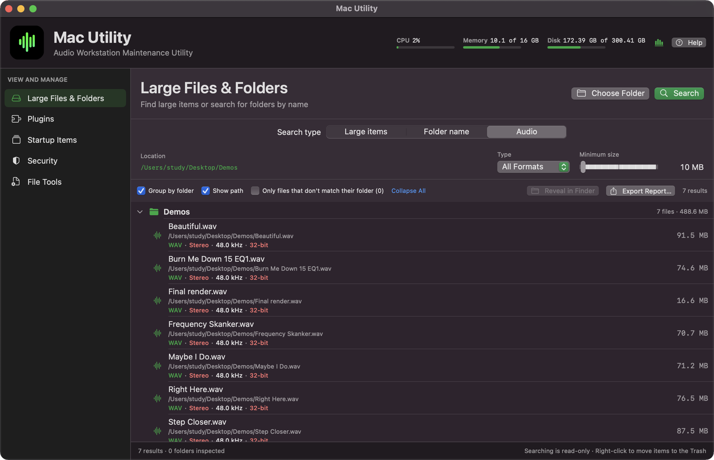
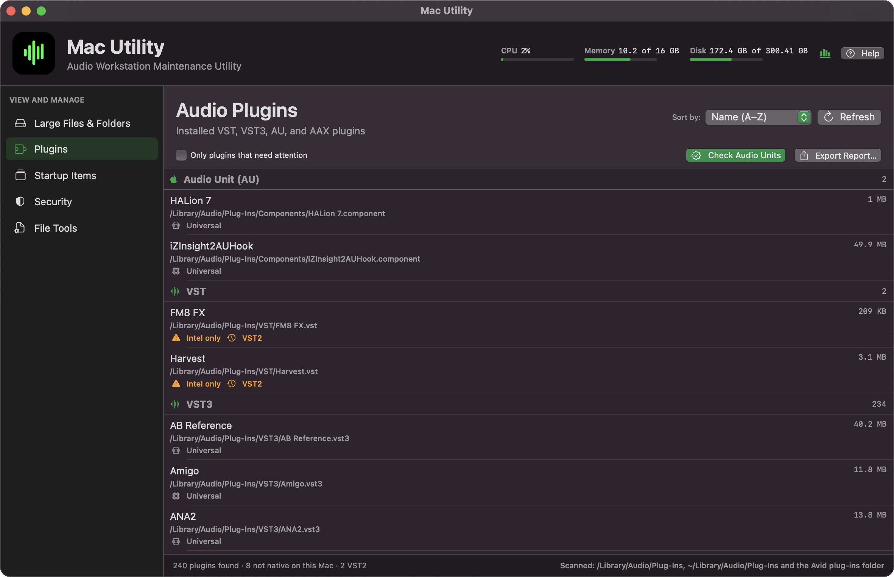
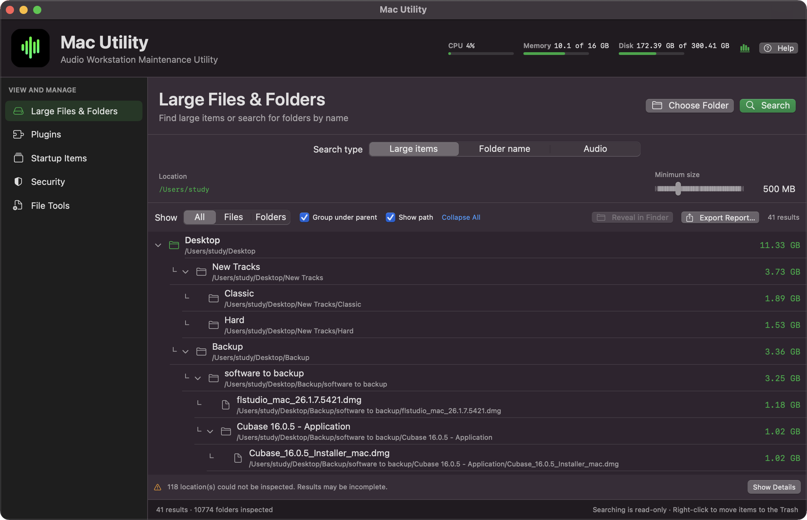
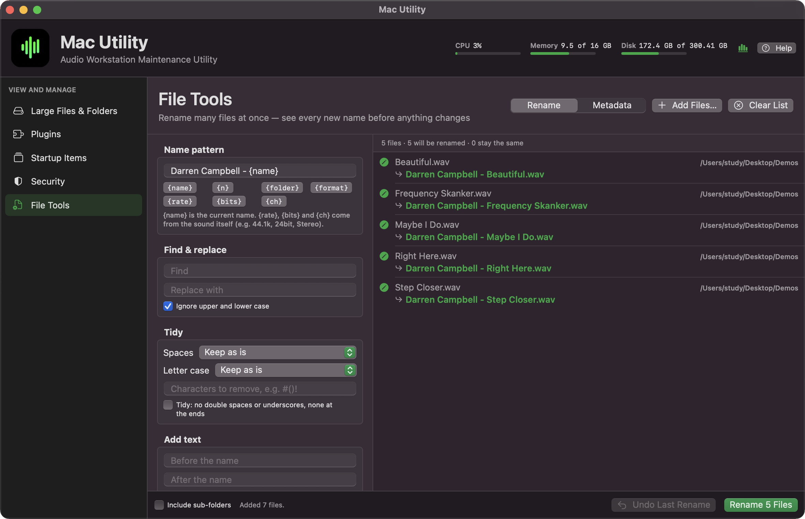
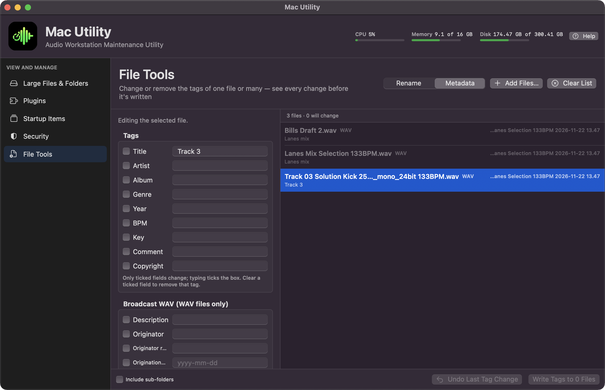
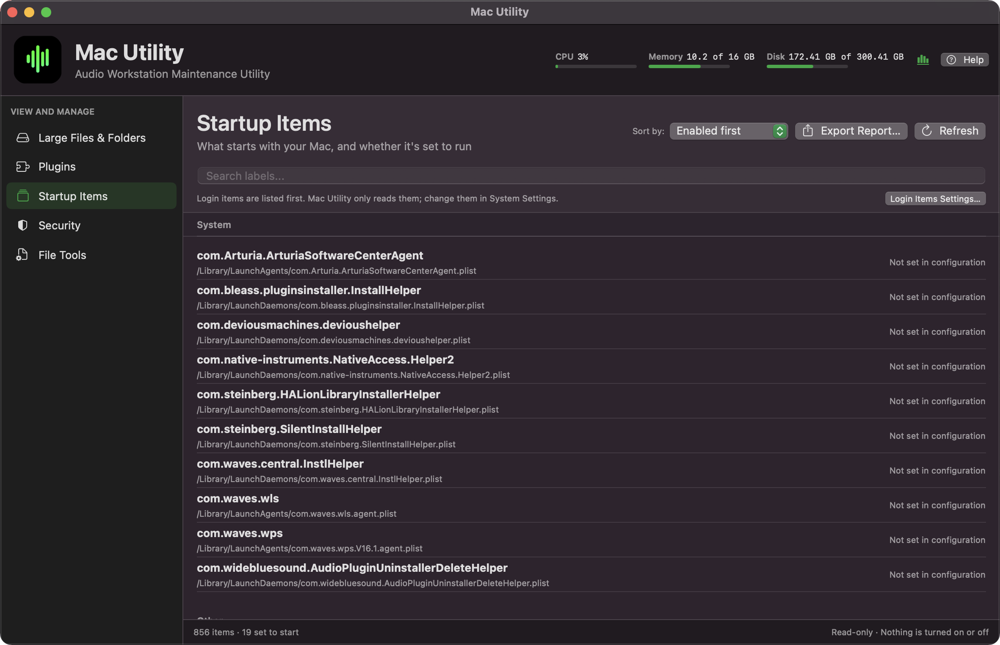
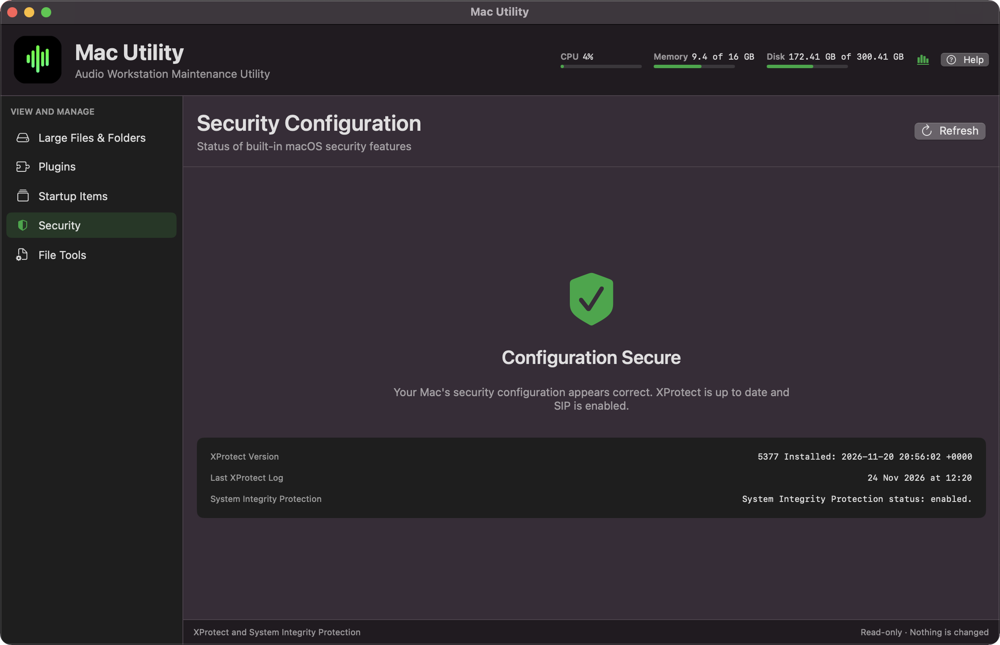

# Mac Utility

**Audio Workstation Maintenance Utility.** Mac Utility is a free macOS app from West 9 Studios that finds what is taking up space, lists your audio plugins and what's set to start with your Mac, and checks that macOS's built-in protection is switched on.

[**Download Mac Utility 1.6**](https://github.com/west9studios/Mac-Utility-Releases/releases/latest) · macOS 13 or later · 4.2 MB · Free, no account or licence key

## What it does

- **Large Files & Folders:** choose any folder and see what is taking up the space, biggest first. Show files or folders only, narrow files down by type (audio, video, images, archives, documents) and group results under their parent folder.
- **Find files and folders by name:** search the whole Mac, one drive or one folder for files or folders by name, or by part of a name, with * and ? for wildcards.
- **Audio search:** find the sound files in a folder, grouped under the folders they are in, with their format, channels, sample rate and bit depth. Handy for tidying a sample library.
- **Plugins:** every Audio Unit, VST, VST3 and AAX plugin installed on your Mac, with the space each one takes, sorted by name or size.
- **Plugin health:** see which plugins won't run natively on your Mac, which are old VST2 plugins and which are installed in several formats, and run Apple's own Audio Unit check on every Audio Unit.
- **Sample library checks:** Audio search marks files whose sample rate or bit depth doesn't match the rest of their folder.
- **Reports:** save any list (large items, audio files, plugins, startup items) as a spreadsheet for Numbers or Excel.
- **Startup Items:** the helpers set to start with your Mac, grouped by who it belongs to, with a search box — and the apps that open when you log in. (The "Allow in the Background" list in System Settings can only be read by an administrator, so it isn't shown; Login Items Settings… opens it.)
- **Security:** whether your Mac's built-in malware protection is up to date and System Integrity Protection is turned on.
- **Straight to Finder:** right-click any result to reveal it in Finder or copy its location.
- **Safe by design:** searching only looks. Mac Utility changes things only when you ask: moving files and folders you choose to the Trash (it asks first, lists what will move, and never touches the Mac's own folders), renaming files, and changing the tags of sound files, in File Tools (every change shown first, undo available).
- **File Tools:** rename many files at once with patterns, find & replace, tidying and numbering, including names built from sample rate, bit depth and channels. See every new name first, and undo the last rename.
- **Tag editing:** change or remove the title, artist, BPM, key and other tags of WAV, AIFF, MP3, FLAC and M4A files, one file or hundreds at once, including Broadcast WAV information. See every change first, and undo the last change.
- **At a glance:** live CPU, memory and disk meters at the top of the window.
- **Dark by default**, like the other West 9 Studios apps, with Light and Match the Mac options.
- **Native on every Mac:** runs on Apple silicon and Intel Macs.

## See it in action

<table>
  <tr>
    <td width="50%"></td>
    <td width="50%"></td>
  </tr>
  <tr>
    <td align="center">Plugins and plugin health</td>
    <td align="center">Large files and folders</td>
  </tr>
  <tr>
    <td width="50%"></td>
    <td width="50%"></td>
  </tr>
  <tr>
    <td align="center">Rename many files, with a preview</td>
    <td align="center">Edit the tags of sound files</td>
  </tr>
  <tr>
    <td width="50%"></td>
    <td width="50%"></td>
  </tr>
  <tr>
    <td align="center">What starts with your Mac</td>
    <td align="center">Built-in protection at a glance</td>
  </tr>
</table>

## What's new

Mac Utility 1.6 is available.

The full history is in the app under **Help > What's New**.

## Install

1. Download the DMG from the [latest release](https://github.com/west9studios/Mac-Utility-Releases/releases/latest).
2. Open it and drag **Mac Utility** into **Applications**.
3. Launch the app. If macOS blocks the first launch, open **System Settings > Privacy & Security** and choose **Open Anyway**.

To see inside folders macOS protects, give Mac Utility **Full Disk Access** in **System Settings > Privacy & Security > Full Disk Access**. Without it, those places are listed as ones that could not be looked at.

Once installed, Mac Utility checks for new versions when it starts. Choose **Update & Relaunch** when the orange notice appears and the app updates itself. Each release also publishes a `.sha256` file if you want to verify your download.

Version 1.6 was released on 25 November 2026. DMG SHA-256: `29ee60fa501a7582f7dc3ad73a505954c825445054254d39b7ab7ed3e3c3eba3`

## More from West 9 Studios

- [Normalizer Pro](https://github.com/west9studios/Normalizer-Pro-Releases): prepare a whole folder of samples in one pass.
- [Mix Reference](https://github.com/west9studios/Mix-Reference-Releases): compare your mix with a reference track.
- [Mac Utility](https://github.com/west9studios/Mac-Utility-Releases): audio workstation maintenance: disk space, plugins, startup items and sample-library tidying.
- [Sample Analyzer](https://github.com/west9studios/Sample-Analyzer-Releases): analyse entire folders of samples for loudness, true peak, instrument detection and mix balance.

## Licence

MAC UTILITY — PLAIN-LANGUAGE LICENCE NOTICE

Mac Utility is free to use. It remains the property of West 9 Studios.

You may not redistribute, resell, modify, or reverse-engineer Mac Utility, or
claim it as your own. No licence key or payment is required to use the app.

Mac Utility is provided “as is”, without any warranty, express or implied.
West 9 Studios is not responsible for loss or damage arising from its use.

OPEN-SOURCE COMPONENTS

Mac Utility contains no third-party or open-source code. It is built only on
the frameworks that come with macOS.

PRIVACY

Mac Utility does not collect, store or send any personal information. It looks
at files, folders, plugins, startup settings and security settings on your Mac
only to show them to you, and nothing it finds leaves your Mac. It changes
nothing on your Mac except moving files and folders you choose to the Trash,
after asking you, renaming files you choose, after showing you every new
name, and changing or removing the tags of sound files you choose, after
showing you every change. The only connection it makes is the
update check: when the app starts, it asks GitHub (github.com) whether a newer
version exists, and it downloads the update from GitHub if you choose to
install it. Like any web request, this lets GitHub see your network address;
GitHub's own privacy policy applies to that. West 9 Studios receives nothing
from these checks. GitHub counts how many times each release is downloaded;
those counts contain no information about who downloaded it.

This is a plain-language notice, not legal advice. It does not replace any
rights or obligations that may apply under the law.
